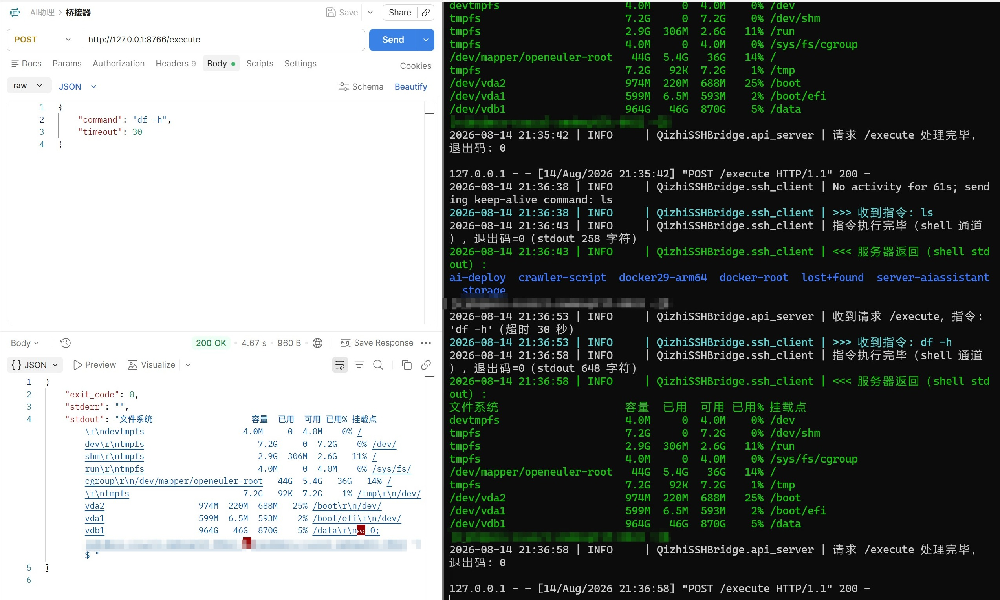

# Qizhi Bastion SSH Bridge · 齐治堡垒机 SSH 桥接器

<div align="center">
  <a href="README.md">中文</a> · <b>English</b>
</div>

> **Give your AI a RESTful API into the servers behind the Qizhi bastion host.**
> Turn operations that used to require clicking around a proprietary Windows client into plain local HTTP calls any program can use.

[](LICENSE)
[](https://github.com/AFAP/plugin-bastion-bridge-qizhi/releases)
[](.github/workflows/release.yml)

**Two ways in, one contract:**

| You are | How you plug in |
|---|---|
| 🎯 **DeepSeek Harness user** | Install the skill in one line, then explicitly invoke `/bastion-qizhi` whenever server access is needed |
| 🌐 **Any AI / agent / script** | The bridge is just a **local RESTful API** (HTTP / SSE / WebSocket) and this README is its API reference — **any AI that can send HTTP requests can use it** (DeepSeek, Claude Code, Cursor, custom agents, curl…), framework-agnostic |

---

## 1. What problem it solves

The Qizhi bastion web console launches `putty.exe` — an **interactive human terminal** — when you click an SSH asset. Humans can see a screen and type commands, but AI programs cannot reliably send commands and get structured results back, so "AI-driven server ops" always falls short at the last mile.

This project replaces that `putty.exe` with a **dedicated bridge**:

1. The bastion console still launches `putty.exe` (PuTTY-style arguments are fully compatible);
2. The bridge parses host/port/account/password and opens an SSH connection via Paramiko;
3. It starts an HTTP/WebSocket API on loopback `127.0.0.1`;
4. An AI assistant runs commands, streams output, and sends interactive input — **operating servers as if typing by hand**.

```
┌────────────────┐   invoke + args   ┌───────────────────┐      SSH      ┌──────────────┐
│  Qizhi bastion  │ ────────────────▶ │ bridge putty.exe  │ ───────────▶ │ target server│
│  web console    │                   │ (this project's   │               │ (Linux/Unix) │
└────────────────┘                   │  build artifact)  │               └──────────────┘
                                      └─────────┬─────────┘
                                                │ 127.0.0.1:<port>
                                                │ HTTP / SSE / WebSocket
                                       ┌────────▼─────────┐
                                       │  AI assistant    │
                                       │  / scripts       │
                                       └──────────────────┘
```

> 💡 **The API is the only integration contract.** The bridge is not tied to any particular AI.
> Whatever framework the model runs in, as long as it can call `POST /execute`, `GET /stream`,
> and `POST /input` (full reference in Section 7 and
> [docs/通用桥接器使用说明.md](docs/通用桥接器使用说明.md)), it can operate the target servers.
> The DeepSeek Harness skill simply "translates" this API spec into that platform's skill format.

## 2. Features

- ✅ **Single EXE, no install**: PyInstaller one-file build; just replace the original `putty.exe`, no admin rights needed to run
- ✅ **Qizhi argument compatible**: supports explicit PuTTY args and `-load` temp session files (`\`, `=`, `:` formats auto-parsed)
- ✅ **Legacy servers supported**: built-in legacy KEX/cipher/MAC algorithms (`group14-sha1`, `3des-cbc`, `hmac-sha1`, …)
- ✅ **Dual-channel execution**: prefers `exec_command`, auto-falls back to an interactive shell for PTY-only restricted servers
- ✅ **Full API**: `/health`, `/execute`, `/stream` (SSE), `/input`, `/ws` (Socket.IO)
- ✅ **Auto port discovery**: live endpoint written to `active_port.txt`, AI reads it with zero config
- ✅ **Idle keep-alive**: sends a harmless command after 60 s of inactivity to prevent bastion disconnects
- ✅ **Readable console**: colored blocks show sanitized launch fields, connection state, commands, exit codes, and server results
- ✅ **Secure by default**: loopback-only binding; command/result bodies are previewed only in the live console, never in log files
- ✅ **DeepSeek Harness skill plugin**: loads only after `/bastion-qizhi`; it is not injected into model context automatically

## 3. Screenshots

| Scenario | Screenshot |
|---|---|
| Type `/bastion-qizhi` in a DeepSeek Harness chat to load the skill explicitly |  |
| The AI runs commands on the target server via the bridge API and gets structured results |  |
| Debugging the local REST API with Postman (`/health`, `/execute`) |  |

> Note: `8766` in the examples is the default port; the actual port is always what `active_port.txt` says.

## 4. Directory structure

```text
plugin-bastion-bridge-qizhi/
├── main.py                  # Entry: parse args → connect → start API
├── params.py                # Qizhi/PuTTY argument parsing
├── ssh_client.py            # SSH engine (Paramiko)
├── api_server.py            # Local AI API (Flask + SocketIO)
├── connection.py            # Connection parameter dataclass
├── command_guard.py         # Server-side internal module
├── config.py                # Local configuration
├── logger.py                # Rotating logs + redaction
├── requirements.txt         # Runtime/build deps (pinned, CI reproducible)
├── putty.spec               # PyInstaller packaging config
├── tests/                   # Unit tests (CI runs python -m unittest discover -s tests)
├── skill/bastion-qizhi/     # DeepSeek Harness skill plugin (installed to ~\.dsh\skills\bastion-qizhi)
│   ├── SKILL.md             #   Skill instructions (the AI's manual)
│   ├── scripts/bridge.py    #   CLI client for the AI (pure stdlib)
│   └── references/          #   API reference + troubleshooting guide
├── scripts/
│   ├── install.ps1          # One-line install (skill plugin + optional bridge EXE)
│   └── uninstall.ps1        # One-line uninstall/restore
├── docs/
│   └── 通用桥接器使用说明.md   # Generic bridge API usage guide (user/AI view)
├── screenshot/              # Effect screenshots (used by "Screenshots")
└── .github/workflows/release.yml  # Tag-triggered build of putty.exe + Release
```

## 5. Quick start

### 5.1 One-line install of the DeepSeek Harness skill (recommended)

```powershell
powershell -ExecutionPolicy Bypass -Command "irm https://raw.githubusercontent.com/AFAP/plugin-bastion-bridge-qizhi/main/scripts/install.ps1 | iex"
```

The script installs the skill bundle to `%USERPROFILE%\.dsh\skills\bastion-qizhi\` (or `$DSH_HOME` if set).
DeepSeek Harness hot-reloads that directory, so the skill works **without a restart**:

- Type `/bastion-qizhi` in a DSH chat to invoke the skill.
- The skill stays out of model-facing catalogs and context until that explicit slash invocation.

### 5.2 Also deploy the bridge EXE (download from Release)

```powershell
# Run inside a local clone (also allows offline skill install)
powershell -ExecutionPolicy Bypass -File scripts\install.ps1 -InstallBridge
```

The script downloads `putty.exe` from the latest Release → backs up the original → replaces it at
`C:\Program Files (x86)\QizhiTech\AccessClient\putty.exe` (auto-UAC when admin rights are needed).

### 5.3 Build from source (developers)

The repo ships no local build script or artifacts — compilation is done by GitHub Actions:

- Push a tag (e.g. `v1.1.0`) → Actions builds `dist\putty.exe` on Windows with the pinned
  `requirements.txt` via PyInstaller and publishes a Release (with SHA-256 checksum) automatically;
- Without a tag, click `Run workflow` on the Actions page to verify a manual build.

To build locally: `python -m pip install -r requirements.txt` then
`python -m PyInstaller putty.spec --clean --noconfirm`; output is `dist\putty.exe`.

## 6. Deploy (replace putty.exe)

The bridge is used by **overwriting** the original client binary:

```text
C:\Program Files (x86)\QizhiTech\AccessClient\putty.exe
```

### 6.1 ① Back up the original first (always do this)

```powershell
Copy-Item "C:\Program Files (x86)\QizhiTech\AccessClient\putty.exe" "C:\Program Files (x86)\QizhiTech\AccessClient\putty.exe.bak" -Force
```

> `scripts\install.ps1 -InstallBridge` does this automatically as `putty.exe.bak.<timestamp>` — no manual step needed.

### 6.2 ② Overwrite with the bridge build

```powershell
Copy-Item ".\dist\putty.exe" "C:\Program Files (x86)\QizhiTech\AccessClient\putty.exe" -Force
```

### 6.3 ③ Verify

Click an SSH asset in the Qizhi console → the bridge connects and starts the API;
check the live port at `%LOCALAPPDATA%\sshbridge\QizhiSSHBridge\active_port.txt`.

### 6.4 Want to restore the official putty.exe?

```powershell
Copy-Item "C:\Program Files (x86)\QizhiTech\AccessClient\putty.exe.bak" "C:\Program Files (x86)\QizhiTech\AccessClient\putty.exe" -Force
```

Or run `scripts\uninstall.ps1 -RestoreBridge` (restores from the newest `.bak`, auto-elevates when needed).

## 7. REST API quick reference

| Operation | Request |
|---|---|
| Health check | `GET /health` |
| Execute command | `POST /execute` `{"command": "df -h", "timeout": 30}` |
| Stream (SSE) | `GET /stream?command=dmesg%20%7C%20tail` |
| Interactive input | `POST /input` `{"data": "y\n"}` |
| WebSocket | `ws://127.0.0.1:<port>/ws` (Socket.IO events: `execute` / `stream` / `input`) |

```bash
# Health check
curl http://127.0.0.1:8766/health

# Execute a command
curl -X POST http://127.0.0.1:8766/execute -H "Content-Type: application/json" -d '{"command": "uname -a"}'
```

Response:

```json
{ "stdout": "Linux server 5.15.0 ...\n", "stderr": "", "exit_code": 0 }
```

Full API reference: [docs/通用桥接器使用说明.md](docs/通用桥接器使用说明.md) and `references/api.md` in the skill bundle.

## 8. Configuration

Config file: `%LOCALAPPDATA%\sshbridge\QizhiSSHBridge\config.json` (auto-generated on first run)

| Key | Default | Notes |
|---|---|---|
| `api_host` | `127.0.0.1` | **Never set to 0.0.0.0**, or LAN clients can call it |
| `api_port` | `8766` | Auto-increments to 8767, 8768… if busy |
| `ssh_connect_timeout` | `15` | SSH handshake timeout (s) |
| `retry_max_attempts` | `3` | Connect retries on failure |
| `keepalive_enabled` | `true` | Idle keep-alive switch |
| `keepalive_interval_seconds` | `60` | Idle time before keep-alive fires |
| `keepalive_command` | `ls` | Keep-alive command (must be harmless) |
| `log_level` | `INFO` | DEBUG / INFO / WARNING / ERROR |
| `log_max_bytes` | `10485760` | Max log file size (10 MB) |
| `log_backup_count` | `5` | Rotating backups kept |
| `console_log` | `true` | Show colored status, command, and response previews in the console |
| `console_verbose` | `false` | Also show detailed INFO/DEBUG technical records in the console |
| `console_output_limit` | `12000` | Per-command or output-field preview limit; full API responses are unaffected |

## 9. Logs & troubleshooting

Logs: `%LOCALAPPDATA%\sshbridge\QizhiSSHBridge\logs\bridge.log` (rotating, 5 kept)

The console uses `>>>` for received parameters or commands and `<<<` for server responses,
including source, duration, exit code, and stdout/stderr sizes. Passwords and interactive-input
bodies remain hidden. Command and response bodies are live-console only; `bridge.log` keeps
metadata such as lengths, exit codes, and connection status.

| Symptom | Where to look |
|---|---|
| Clicking an SSH asset does nothing | Check putty.exe was replaced in the right path |
| API unreachable | Read the actual port from `active_port.txt` (it may have incremented) |
| `/health` returns `connected: false` | Check the log tail: auth failure / network issue / argument parse error |
| `no acceptable kex algorithm` | Built-in Paramiko 2.12.0 already supports legacy algorithms; open an Issue if it still appears |

Full troubleshooting guide: [docs/通用桥接器使用说明.md](docs/通用桥接器使用说明.md) and `references/troubleshooting.md` in the skill bundle.

## 10. Security & compliance (read this)

- Replacing `putty.exe` means the bridge **takes over credentials issued by the bastion** — **deploy only in authorized environments**.
- The API has no auth but binds loopback only, and **any local process can call it** — do not run on shared terminals.
- Password, token, and API-key arguments are redacted; command/output bodies are never written to log files.
- The console can display sensitive server output. Close it after use and do not share screenshots containing business data.
- See [SECURITY.md](SECURITY.md).

## 11. FAQ

**Q: Antivirus flags the EXE?** PyInstaller one-file EXEs often trigger false positives; whitelist it, or run from source with `python main.py <args>`.

**Q: Which Qizhi versions are supported?** Argument parsing is based on PuTTY-compatible invocation; if your version passes args differently, check the `Parsing argv:` log line and add a branch in `params.py` (PRs welcome).

**Q: Do multiple bridge instances conflict?** No. Ports auto-increment and each instance writes its own `active_port.txt` — the file is the source of truth.

**Q: Can the password leak?** It lives only in process memory; logs and `to_dict()` diagnostic output are redacted to `***`.

## 12. Development & CI

Module layering: entry `main.py` → args `params.py` → SSH engine `ssh_client.py` → API `api_server.py`; the
external API contract stays consistent with [docs/通用桥接器使用说明.md](docs/通用桥接器使用说明.md).
To adapt to another bastion vendor, replace only `params.py` and adjust the app name/port in `main.py`.

**CI release flow**: push a tag (e.g. `v1.0.0`) → GitHub Actions builds `putty.exe` on Windows with the
pinned `requirements.txt` → publishes a Release automatically (with SHA-256 checksum).
Manual builds are available via `Run workflow` on the Actions page.

## 13. Related docs

- [docs/通用桥接器使用说明.md](docs/通用桥接器使用说明.md) — generic bridge API usage guide (user/AI view)
- [SECURITY.md](SECURITY.md) — security design & risk notice
- [README.md](README.md) — 中文主文档 (Chinese README)

## 14. License

[MIT](LICENSE) © plugin-bastion-bridge-qizhi contributors

> Disclaimer: for authorized operations, security testing, and research only. Users are responsible for lawful use.
